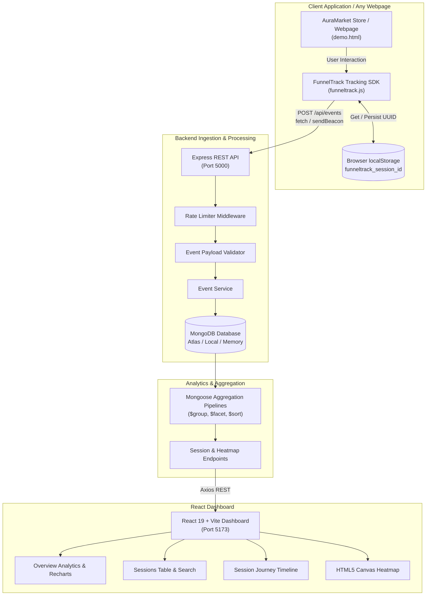

# FunnelTrack — User Behavior Analytics Platform

> Built for the **CausalFunnel Full Stack Engineer Hiring Assignment**.  
> A full-stack user behavior analytics assignment featuring a lightweight tracking SDK, MongoDB-backed REST APIs, chronological session journeys, and viewport-normalized click heatmaps.

---

## Current implementation notes

FunnelTrack is a local-first assignment application with a React/Vite dashboard, Express/Mongoose API, MongoDB event store, standalone browser SDK, and demo storefront. Session IDs are stored in first-party `localStorage` and expire after **30 minutes of inactivity** (sliding expiry). Click positions use viewport-relative pixels and include viewport dimensions so the dashboard can normalize them. The application does not collect input values; password fields and elements marked `data-private="true"` / `data-sensitive="true"` are excluded from click tracking. Events have no automatic retention deletion policy.

The API also exposes `GET /api/pages` and `GET /api/heatmap?url=<encoded-url>`; the dashboard continues to use equivalent `/api/heatmap/pages` and `/api/heatmap/clicks` routes. The tracker is served from `GET /tracker.js`. Session listing supports `?page=1&limit=10&search=<session-id>` and returns `distinct_pages` per session.

### Quick start

1. Install Node.js 18+ and run MongoDB locally, or create a MongoDB Atlas database.
2. Copy `server/.env.example` to `server/.env`, set `MONGODB_URI`, and set `CLIENT_ORIGIN` to the dashboard and demo origins (comma-separated).
3. Install packages in both workspaces with `npm run install:all` from the repository root.
4. Start the API with `npm --prefix server run dev` and the dashboard with `npm --prefix client run dev`.
5. Serve the demo from `tracker/` (for example, `python -m http.server 5500`) and open `http://localhost:5500/demo.html`.

The demo calls the SDK at `http://localhost:5000/api`; for another deployment set `window.CAUSALFUNNEL_CONFIG.apiUrl` before loading `/tracker.js`. To publish the tracker, serve `tracker/funneltrack.js` at the backend `/tracker.js` route or host that file at a stable HTTPS URL.

### Deployment and known limits

Set `NODE_ENV=production`, `MONGODB_URI`, `PORT`, and `CLIENT_ORIGIN` on the API host. `CLIENT_ORIGIN` must list every dashboard and tracked-site origin. Build the dashboard with `npm --prefix client run build`; deploy `client/dist` to Vercel/Netlify and set `VITE_API_BASE_URL` to the deployed API's `/api` URL before building. The dashboard has no authentication; restrict access appropriately. There is no hosted deployment or GitHub remote configured in this workspace.

The dashboard and Express API source are TypeScript. Tailwind CSS is configured alongside the existing authored design-system CSS, and Vitest/React Testing Library cover the dashboard's sessions, journey, heatmap, and API-error states. The backend suite uses Jest/Supertest and an ephemeral MongoDB test server; it needs a MongoDB binary present or downloadable. A production MongoDB URI is required outside tests; development does not silently fall back to ephemeral storage.

GitHub publication commands after creating an authorized empty repository:

```bash
git init
git add .
git commit -m "Build user analytics application"
git branch -M main
git remote add origin <your-repository-url>
git push -u origin main
```

## Table of Contents

1. [Project Overview](#1-project-overview)
2. [Problem Statement & Solution](#2-problem-statement--solution)
3. [Key Features](#3-key-features)
4. [System Architecture](#4-system-architecture)
5. [Technology Stack](#5-technology-stack)
6. [Folder Structure](#6-folder-structure)
7. [Database Schema & Index Strategy](#7-database-schema--index-strategy)
8. [REST API Documentation](#8-rest-api-documentation)
9. [Prerequisites](#9-prerequisites)
10. [Local Installation & Setup (PowerShell Guide)](#10-local-installation--setup-powershell-guide)
11. [MongoDB Configuration (Atlas & Local)](#11-mongodb-configuration-atlas--local)
12. [Environment Variables](#12-environment-variables)
13. [Starting the Application](#13-starting-the-application)
14. [Opening the Demo E-Commerce Store](#14-opening-the-demo-e-commerce-store)
15. [Verifying Tracked Data End-to-End](#15-verifying-tracked-data-end-to-end)
16. [Inspecting Sessions & Chronological Journeys](#16-inspecting-sessions--chronological-journeys)
17. [Using the Responsive Click Heatmap](#17-using-the-responsive-click-heatmap)
18. [Automated Testing Guide](#18-automated-testing-guide)
19. [Frontend Production Build](#19-frontend-production-build)
20. [Deployment Guide (Render, Vercel, Atlas)](#20-deployment-guide-render-vercel-atlas)
21. [Security, Privacy & Rate Limiting](#21-security-privacy--rate-limiting)
22. [Assumptions & Technical Trade-offs](#22-assumptions--technical-trade-offs)
23. [Known Limitations & Future Roadmap](#23-known-limitations--future-roadmap)

---

## 1. Project Overview

**FunnelTrack** is an end-to-end telemetry and analytics suite designed to provide granular insight into how users navigate web applications. Unlike bulky third-party scripts, FunnelTrack is built around an embeddable, vanilla JavaScript tracking SDK (`funneltrack.js`) that captures high-fidelity interactions without invading user privacy or relying on third-party cookies.

Interactions are processed by an Express.js ingestion pipeline, persisted in MongoDB, aggregated on demand via native aggregation pipelines, and rendered on an analytics dashboard with interactive timelines and responsive HTML5 canvas heatmaps.

---

## 2. Problem Statement & Solution

Modern product and growth teams need to understand:
- Where users drop off in conversion funnels.
- Which specific UI elements capture physical clicks.
- How user interaction sequences unfold chronologically across pages.

Many off-the-shelf tools either introduce massive bundle bloat, compromise user privacy via device fingerprinting, or suffer from coordinate distortion when overlaying mobile clicks onto fixed desktop screenshots.

**The FunnelTrack Solution:**
1. **Lightweight SDK**: ~4KB vanilla JavaScript SDK without external runtime dependencies.
2. **Viewport-Normalized Coordinates**: Pairs each click $(X, Y)$ with the user's active viewport dimensions $(\text{width}, \text{height})$ to project clicks onto responsive heatmaps accurately.
3. **Transparent Aggregation**: Computes session counts, durations, and activity distribution on the fly using MongoDB aggregation pipelines without redundant counters.
4. **Zero-PII Privacy Protection**: Automatic omission of password fields, sensitive attributes, and credentials.

---

## 3. Key Features

- **Automated Behavioral Telemetry**: Captures initial page views, client-side route changes, and element clicks.
- **Persistent Non-Invasive Sessions**: UUID v4 browser identifier persisted in `localStorage` with fallback handling.
- **Interactive AuraMarket Demo Store**: Realistic e-commerce storefront with Quick View modals, category filters, and a **Live Tracker Dock** showing real-time event counts and session switching.
- **Modular REST API**: Rate limiting, payload validation, centralized error handling, and explicit MongoDB connection requirements.
- **Chronological Journey Replay**: Visual step-by-step timeline of user sessions with interaction badges, duration deltas, and coordinate chips.
- **Viewport-Normalized Click Heatmap**: HTML5 canvas rendering supporting **Thermal Heat Glow**, **Precision Pinpoint Markers**, and **Hybrid Overlay** modes with hover inspection tooltips.
- **Automated Tests**: Jest/Supertest API tests and Node's built-in test runner for the standalone SDK.

---

## 4. System Architecture



---

## 5. Technology Stack

| Layer | Technology | Version | Purpose |
| :--- | :--- | :--- | :--- |
| **Tracking SDK** | Vanilla JavaScript | ES6+ | Framework-agnostic client tracking library (~4KB) |
| **Demo Webpage** | HTML5, CSS3, JS | Standard | High-conversion lifestyle storefront with live dock |
| **Frontend Framework** | React.js + TypeScript | 19.0.0 / 5.9 | Component-based typed user interface |
| **Build Tool** | Vite | 8.3.4 | Ultra-fast HMR and optimized production bundling |
| **Routing** | React Router | 6.29.0 | Client-side dashboard routing |
| **Data Fetching** | Axios | 1.7.9 | HTTP client with centralized interceptors |
| **Data Visualization** | Recharts | 2.15.1 | Composable SVG analytics charts |
| **Iconography** | Lucide React | 0.475.0 | Modern SVG iconography |
| **Styling** | Tailwind CSS + authored CSS | 3.4 | Utility styling and existing dashboard design system |
| **Backend Runtime** | Node.js | >= 18.x | Server environment |
| **Backend Framework**| Express.js | 4.21.2 | REST API routing and middleware pipeline |
| **Database ODM** | Mongoose | 8.12.1 | Schema validation and aggregation queries |
| **Database** | MongoDB | 7.x / Atlas | Scalable document store with compound indexes |
| **Automated Testing**| Jest & Supertest | 29.7.0 / 7.0 | Backend unit and integration test runner |
| **Frontend Testing** | Vitest & React Testing Library | 5 / 16 | Component and UI state tests |
| **Test In-Memory DB**| mongodb-memory-server | 10.1.4 | Isolated MongoDB instance for backend tests |

---

## 6. Folder Structure

```
funneltrack/
├── client/                     # React 19 + Vite Frontend Dashboard
│   ├── public/                 # Static assets & favicon
│   ├── src/
│   │   ├── components/         # Reusable UI components
│   │   │   ├── ChartComponents.tsx # Recharts Donut & Timeline
│   │   │   ├── DataTable.tsx   # Tabular data grid with custom cells
│   │   │   ├── EmptyState.tsx  # Empty state with demo launcher instructions
│   │   │   ├── ErrorState.tsx  # Error banner with retry trigger
│   │   │   ├── EventTimeline.tsx# Chronological journey timeline
│   │   │   ├── Header.tsx      # Top header with live MongoDB status pill
│   │   │   ├── HeatmapCanvas.tsx# Viewport-normalized canvas heatmap
│   │   │   ├── LoadingState.tsx# Animated spinner loading screen
│   │   │   ├── MetricCard.tsx  # KPI summary card with color variants
│   │   │   ├── Pagination.tsx  # Page numbers and page-size selector
│   │   │   └── Sidebar.tsx     # Navigation drawer with demo store button
│   │   ├── pages/              # Application views
│   │   │   ├── HeatmapPage.tsx # Click heatmap visualization
│   │   │   ├── OverviewPage.tsx# High-level KPIs & activity charts
│   │   │   ├── SessionDetailsPage.tsx # Journey timeline for single session
│   │   │   └── SessionsPage.tsx# Paginated sessions table & search
│   │   ├── layouts/
│   │   │   └── DashboardLayout.tsx
│   │   ├── services/
│   │   │   └── api.ts          # Centralized Axios API client
│   │   ├── utils/
│   │   │   └── formatters.ts   # Timestamps, durations, and URL formatting
│   │   ├── index.css           # Design tokens, typography, and utility classes
│   │   ├── App.tsx             # React Router hierarchy
│   │   └── main.tsx            # React root entrypoint
│   ├── package.json
│   ├── .env.example
│   └── vite.config.js
│
├── server/                     # Express.js REST API & Ingestion Engine
│   ├── src/
│   │   ├── config/
│   │   │   └── db.ts           # Mongoose connection to configured MongoDB
│   │   ├── models/
│   │   │   └── Event.ts        # Event schema with compound indexes
│   │   ├── controllers/
│   │   │   ├── analyticsController.ts
│   │   │   ├── eventController.ts
│   │   │   ├── healthController.ts
│   │   │   ├── heatmapController.ts
│   │   │   └── sessionController.ts
│   │   ├── services/
│   │   │   ├── analyticsService.ts
│   │   │   ├── eventService.ts
│   │   │   ├── heatmapService.ts
│   │   │   └── sessionService.ts
│   │   ├── middleware/
│   │   │   ├── errorHandler.ts # Centralized error & 404 handler
│   │   │   └── rateLimiter.ts  # Ingestion & API rate limiting
│   │   ├── validators/
│   │   │   └── eventValidator.ts # Payload validation & coordinate bounds checks
│   │   ├── routes/
│   │   │   └── api.ts          # API route definitions
│   │   ├── app.ts              # Express app setup, CORS, body limits
│   │   └── server.ts           # Server entrypoint with graceful shutdown
│   ├── tests/
│   │   └── api.test.js         # Jest + Supertest API integration test suite
│   ├── package.json
│   └── .env.example
│
├── tracker/                    # Standalone Tracking SDK & Demo
│   ├── funneltrack.js          # Reusable vanilla JS tracker SDK (~4KB)
│   ├── demo.html               # AuraMarket lifestyle store with live dock
│   ├── demo.css                # Demo storefront stylesheet
│   └── README.md               # SDK integration documentation
│
├── package.json                # Monorepo convenience scripts
├── README.md                   # Complete architectural and setup guide
└── .gitignore
```

---

## 7. Database Schema & Index Strategy

### Schema Definition (`server/src/models/Event.ts`)

```javascript
{
  session_id:      { type: String, required: true, trim: true, index: true },
  event_type:      { type: String, required: true, enum: ['page_view', 'click'] },
  page_url:        { type: String, required: true, trim: true },
  timestamp:       { type: Date,   required: true, default: Date.now, index: true },
  page_title:      { type: String, maxlength: 300 },
  referrer:        { type: String, maxlength: 2048 },
  element_type:    { type: String, maxlength: 40 },
  x:               { type: Number, min: 0 },
  y:               { type: Number, min: 0 },
  click_x:         { type: Number, default: null }, // Required for 'click', null for 'page_view'
  click_y:         { type: Number, default: null }, // Required for 'click', null for 'page_view'
  viewport_width:  { type: Number, default: null }, // Positive integer
  viewport_height: { type: Number, default: null }, // Positive integer
  createdAt:       { type: Date,   default: Date.now }
}
```

### Documented Index Rationale
1. **`{ session_id: 1, timestamp: 1 }` (Compound Index)**:
   - Powers `GET /api/sessions/:sessionId/events`.
   - Guarantees $O(\log N)$ fast chronological event retrieval sorted by time within any given session.
2. **`{ event_type: 1, page_url: 1 }` (Compound Index)**:
   - Powers `GET /api/heatmap/pages` and `GET /api/heatmap?url=...`.
   - Allows instant index-only filtering of clicks for specific URLs.
3. **`{ page_url: 1 }` (Single Field Index)**:
   - Supports the all-events distinct URL query used by `GET /api/pages`.
4. **`{ timestamp: -1 }` (Descending Index)**:
   - Optimizes recent activity feeds and dashboard time-series aggregations.
5. **`{ session_id: 1 }` (Single Field Index)**:
   - Accelerates `$group` pipelines when calculating session summaries across high document counts.

---

## 8. REST API Documentation

### Base URL: `http://localhost:5000/api`

### 1. Ingest Event
- **Endpoint**: `POST /api/events`
- **Rate Limit**: 600 requests / minute per IP
- **Description**: Stores user interaction events. Coordinates must be non-negative numbers for clicks and `null` for page views.
- **Request Body (Click)**:
  ```json
  {
    "session_id": "73e93a0d-3cf5-4cf5-b1a7-193796d8e578",
    "event_type": "click",
    "page_url": "http://localhost:5500/demo.html",
    "timestamp": "2026-10-12T12:00:00.000Z",
    "click_x": 480,
    "click_y": 320,
    "viewport_width": 1440,
    "viewport_height": 900
  }
  ```
- **Response (`201 Created`)**:
  ```json
  {
    "success": true,
    "message": "Event stored successfully",
    "data": {
      "id": "670aa5e20d9e4c19a84d1290"
    }
  }
  ```

### 2. List Aggregated Sessions
- **Endpoint**: `GET /api/sessions?page=1&limit=10`
- **Description**: Returns sessions grouped via MongoDB aggregation, sorted by most recently active session.
- **Response (`200 OK`)**:
  ```json
  {
    "success": true,
    "data": {
      "sessions": [
        {
          "session_id": "73e93a0d-3cf5-4cf5-b1a7-193796d8e578",
          "total_events": 8,
          "page_views": 2,
          "clicks": 6,
          "first_event_at": "2026-10-12T11:58:12.000Z",
          "last_event_at": "2026-10-12T12:04:45.000Z"
        }
      ],
      "pagination": {
        "currentPage": 1,
        "limit": 10,
        "totalSessions": 1,
        "totalPages": 1,
        "hasNextPage": false,
        "hasPrevPage": false
      }
    }
  }
  ```

### 3. Chronological Session Events
- **Endpoint**: `GET /api/sessions/:sessionId/events`
- **Description**: Returns all events belonging to the session sorted chronologically (`timestamp: 1`).
- **Response (`200 OK`)**:
  ```json
  {
    "success": true,
    "data": {
      "session_id": "73e93a0d-3cf5-4cf5-b1a7-193796d8e578",
      "total_events": 2,
      "events": [
        {
          "_id": "670aa5e20d9e4c19a84d1290",
          "session_id": "73e93a0d-3cf5-4cf5-b1a7-193796d8e578",
          "event_type": "page_view",
          "page_url": "http://localhost:5500/demo.html",
          "timestamp": "2026-10-12T11:58:12.000Z",
          "click_x": null,
          "click_y": null,
          "viewport_width": 1440,
          "viewport_height": 900
        },
        {
          "_id": "670aa5e20d9e4c19a84d1291",
          "session_id": "73e93a0d-3cf5-4cf5-b1a7-193796d8e578",
          "event_type": "click",
          "page_url": "http://localhost:5500/demo.html",
          "timestamp": "2026-10-12T11:58:24.000Z",
          "click_x": 480,
          "click_y": 320,
          "viewport_width": 1440,
          "viewport_height": 900
        }
      ]
    }
  }
  ```

### 4. Distinct Tracked Pages
- **Endpoint**: `GET /api/pages`
- **Description**: Returns all distinct tracked page URLs for the heatmap selector.

### 5. Distinct Heatmap Pages
- **Endpoint**: `GET /api/heatmap/pages`
- **Description**: Returns all unique page URLs that have recorded clicks.
- **Response (`200 OK`)**:
  ```json
  {
    "success": true,
    "data": {
      "pages": [
        "http://localhost:5500/demo.html",
        "http://localhost:5500/demo.html#deals"
      ]
    }
  }
  ```

### 6. Heatmap Clicks for Page
- **Endpoint**: `GET /api/heatmap/clicks?pageUrl=http://localhost:5500/demo.html`
- **Description**: Returns click coordinates and viewport metrics for the requested URL.
- **Alias**: `GET /api/heatmap?url=<encoded-page-url>`
- **Response (`200 OK`)**:
  ```json
  {
    "success": true,
    "data": {
      "page_url": "http://localhost:5500/demo.html",
      "total_clicks": 25,
      "returned_clicks": 25,
      "clicks": [
        {
          "_id": "670aa5e20d9e4c19a84d1291",
          "session_id": "73e93a0d-3cf5-4cf5-b1a7-193796d8e578",
          "click_x": 480,
          "click_y": 320,
          "viewport_width": 1440,
          "viewport_height": 900,
          "timestamp": "2026-10-12T11:58:24.000Z"
        }
      ]
    }
  }
  ```

### 7. Analytics Overview
- **Endpoint**: `GET /api/analytics/overview`
- **Description**: Aggregates total sessions, total events, page views, clicks, and interaction time-series.
- **Response (`200 OK`)**:
  ```json
  {
    "success": true,
    "data": {
      "total_sessions": 12,
      "total_events": 85,
      "total_page_views": 28,
      "total_clicks": 57,
      "event_distribution": [
        { "event_type": "page_view", "name": "Page Views", "count": 28 },
        { "event_type": "click", "name": "Clicks", "count": 57 }
      ],
      "recent_sessions": [...],
      "activity_timeline": [...]
    }
  }
  ```

### 8. Health Check
- **Endpoint**: `GET /api/health`
- **Description**: Returns API and database status without exposing secrets.
- **Response (`200 OK`)**:
  ```json
  {
    "status": "ok",
    "message": "FunnelTrack API is operational",
    "timestamp": "2026-10-12T12:00:00.000Z",
    "uptime": 128,
    "database": {
      "status": "connected"
    }
  }
  ```

---

## 9. Prerequisites

- **Node.js**: Version 20.19+ (or 22.12+) (`node -v`, required by Vite 8)
- **npm**: Version 10+ (`npm -v`)
- **MongoDB**: A local MongoDB daemon (`mongodb://127.0.0.1:27017`) or MongoDB Atlas connection string. The API fails fast when the configured database is unavailable.

---

## 10. Local Installation & Setup (PowerShell Guide)

Open PowerShell in the project directory:

```powershell
# Navigate into the project folder
cd funneltrack

# 1. Install Server Dependencies
cd server
npm install

# 2. Install Client Dependencies
cd ../client
npm install

# Return to project root
cd ..
```

---

## 11. MongoDB Configuration (Atlas & Local)

### Option A: Local MongoDB Service
Ensure your local MongoDB daemon is running on port 27017:
```env
MONGODB_URI=mongodb://127.0.0.1:27017/funneltrack
```

### Option B: MongoDB Atlas (Cloud)
In `server/.env`, set your Atlas connection string:
```env
MONGODB_URI=mongodb+srv://<username>:<password>@cluster0.mongodb.net/funneltrack?retryWrites=true&w=majority
```

---

## 12. Environment Variables

### Server (`server/.env`)
```env
PORT=5000
MONGODB_URI=mongodb://127.0.0.1:27017/funneltrack
CLIENT_ORIGIN=http://localhost:5173,http://localhost:5500
NODE_ENV=development
```

### Client (`client/.env`)
```env
VITE_API_BASE_URL=http://localhost:5000/api
```

---

## 13. Starting the Application

### Step 1: Start Backend Server (Terminal 1)
```powershell
cd funneltrack/server
npm start
```
*Expected Output:*
```
===============================================
  FunnelTrack Server running on port 5000
  Environment: development
  Health Check: http://localhost:5000/api/health
===============================================
```

### Step 2: Start React Frontend (Terminal 2)
```powershell
cd funneltrack/client
npm run dev
```
*Expected Output:*
```
  VITE v8.3.4  ready in 250 ms

  ➜  Local:   http://localhost:5173/
  ➜  Network: use --host to expose
```

---

## 14. Opening the Demo E-Commerce Store

To generate authentic user interactions:

### Option A: Using Python Simple Server (Recommended)
In a new terminal:
```powershell
cd funneltrack/tracker
python -m http.server 5500
```
Open your browser to: **`http://localhost:5500/demo.html`**

### Option B: Direct File Opening
Double-click `funneltrack/tracker/demo.html` or open it directly in Google Chrome / Microsoft Edge. The tracking SDK automatically supports local origins.

---

## 15. Verifying Tracked Data End-to-End

1. Open `http://localhost:5500/demo.html` in your browser.
2. Note the **FunnelTrack Dock** floating at the bottom showing:
   - `🟢 FunnelTrack Active`
   - Active Session ID (e.g. `8f4b1a20...`)
   - Real-time click and page view counters
3. Interact with the store:
   - Click **"Shop Curated Gear"**
   - Click category filter pills (**Audio & Sound**, **Keyboards**)
   - Click **"Quick View"** on product cards and adjust the quantity
   - Click **"Add to Cart"**
   - Click **"Copy Coupon Code"**
4. Check your browser Network tab (F12) to see `POST http://localhost:5000/api/events` returning `HTTP 201 Created`.
5. Click **"Open Dashboard ↗"** on the dock or navigate to `http://localhost:5173`.
6. Watch your live metrics update in real-time!

---

## 16. Inspecting Sessions & Chronological Journeys

1. In the React dashboard, click **"Sessions"** in the sidebar.
2. View the paginated table showing:
   - Unique Session IDs
   - Total Events, Page Views, and Clicks
   - Calculated Session Duration (e.g. `1m 24s`)
   - First and Last Event Timestamps
3. Click any session row or click **"View Journey →"**.
4. Inspect the **Chronological Interaction Journey**:
   - Distinct icons and badges for **PAGE VIEW** (green) vs **CLICK** (indigo).
   - Time elapsed deltas between consecutive steps (e.g. `+3.4s`).
   - Exact client coordinates $(X, Y)$ and native viewport dimensions $(W \times H)$.
   - Normalized relative percentage position on screen.

---

## 17. Using the Responsive Click Heatmap

1. Click **"Click Heatmap"** in the sidebar.
2. Use the **Page URL dropdown** to select the tracked page (e.g., `http://localhost:5500/demo.html`).
3. View the rendered **Browser Viewport Wireframe Canvas**:
   - **Hybrid Mode**: Blends thermal heat density glow with pinpoint click markers.
   - **Heat Glow Mode**: Continuous thermal gradient (Blue $\rightarrow$ Cyan $\rightarrow$ Green $\rightarrow$ Yellow $\rightarrow$ Red).
   - **Markers Mode**: Discrete target markers with pulsing rings.
   - **Radius Slider**: Interactively adjust thermal blur radius (15px to 45px).
4. **Interactive Hover & Inspection**:
   - Hover over any marker to view a floating tooltip with raw coordinates and timestamp.
   - Click on any marker to pin the **Selected Interaction Card**, revealing the exact Session ID, client resolution, and normalized coordinate breakdown.

### Coordinate Normalization Formula
$$\text{Normalized } X = \frac{\text{click\_x}}{\text{viewport\_width}}$$
$$\text{Normalized } Y = \frac{\text{click\_y}}{\text{viewport\_height}}$$

This ensures clicks from a 1366×768 laptop, a 1920×1080 monitor, and a 2560×1440 display map accurately to the same proportional interactive regions without distortion.

---

## 18. Automated Testing Guide

The backend suite uses **Jest**, **Supertest**, and `mongodb-memory-server`; its MongoDB binary must already be cached or downloadable. The SDK has a dependency-free Node test suite. The UI suite uses Vitest and React Testing Library.

### Running Tests
```powershell
npm run test:all
```

The API suite covers ingestion, validation, counts, ordering, session filtering, page listing, heatmap aliases, and health status. The UI suite covers sessions, the user journey, heatmap loading, and API error state. Backend tests use `mongodb-memory-server`; a MongoDB binary must be cached or downloadable. If MongoDB is installed locally, set `MONGOMS_SYSTEM_BINARY` and `MONGOMS_VERSION` before running `npm --prefix server test` to avoid a download.

---

## 19. Frontend Production Build

To typecheck the API and dashboard and produce their optimized bundles from the repository root:

```powershell
npm run build
```

Output: `server/dist/` contains compiled API code; `client/dist/` contains the dashboard HTML, CSS, and JavaScript bundles.

To preview the production build locally:
```powershell
npm run preview
```

---

## 20. Deployment Guide (Render, Vercel, Atlas)

### 1. Database: MongoDB Atlas
1. Create an Atlas cluster at [mongodb.com/atlas](https://www.mongodb.com/atlas).
2. Create a database user and allow network access from the backend host's IP range.
3. Copy the connection string: `mongodb+srv://<user>:<password>@cluster0.mongodb.net/funneltrack?retryWrites=true&w=majority`.

### 2. Backend: Render.com
1. Create a new **Web Service** pointing to your repository.
2. Root Directory: repository root (the API serves the SDK from `tracker/`).
3. Build Command: `npm install --prefix server && npm --prefix server run build`.
4. Start Command: `npm --prefix server start`.
5. Environment Variables:
   - `NODE_ENV`: `production`
   - `PORT`: `5000`
   - `MONGODB_URI`: `<Your MongoDB Atlas connection URI>`
   - `CLIENT_ORIGIN`: comma-separated dashboard and tracked-site origins, for example `https://your-frontend.vercel.app,https://shop.example.com`

### 3. Frontend: Vercel
1. Import repository on [vercel.com](https://vercel.com).
2. Root Directory: `client`.
3. Framework Preset: **Vite**.
4. Build Command: `npm run build`.
5. Output Directory: `dist`.
6. Environment Variables:
   - `VITE_API_BASE_URL`: `https://your-backend.onrender.com/api`

---

## 21. Security, Privacy & Rate Limiting

- **No Invasive Fingerprinting**: Does not probe audio contexts, WebGL hashes, or canvas fingerprints. Uses clean client-generated UUID v4 tokens.
- **Form Privacy Filtering**: The tracking SDK automatically excludes elements with `type="password"`, `data-private="true"`, or `data-sensitive="true"`. Form input keystrokes are never recorded.
- **Coordinate Bounds Validation**: Ingestion rejects non-numeric or negative coordinates. Clicks that exceed reasonable viewport bounds (+100px) are rejected.
- **Strict Rate Limiting**: Ingestion endpoints are rate-limited to 600 requests per minute per IP via `express-rate-limit` to prevent denial-of-service spam while allowing high-speed user interactions.
- **No Stack Trace Leaks**: Centralized error middleware suppresses internal stack traces in production.

---

## 22. Assumptions & Technical Trade-offs

1. **Session expiration**:
   - *Decision*: One browser ID is reused until 30 minutes of inactivity; event activity refreshes the expiry.
   - *Trade-off*: Browser storage is first-party and clearable; inaccessible storage falls back to an in-memory ID for that page load.
2. **Normalized Coordinates vs DOM Element Selectors**:
   - *Decision*: Heatmap coordinates are normalized by viewport dimensions (`clientX / innerWidth`).
   - *Rationale*: Normalization enables cross-device representation across different screen resolutions without requiring fragile XPath / CSS selector reconstruction.
3. **Vanilla JS Tracking SDK**:
   - *Decision*: Built with pure JavaScript without external dependencies.
   - *Rationale*: Guarantees compatibility with any web application, CMS, or static HTML site.

---

## 23. Known Limitations & Future Roadmap

- **Dynamic DOM Reflows**: If a page has collapsible accordions or infinite scroll that heavily shifts element positions, viewport-relative coordinates will reflect where the user clicked relative to the viewport at that moment. Future versions could combine CSS selector matching with coordinate capture.
- **Session Replay Video**: Adding DOM mutation recording (e.g. `rrweb`) for full video replay.
- **Funnels & Conversion Drop-off Builder**: Multi-step funnel path visualizer tracking step-by-step completion percentages.

---

## 24. License

This project is licensed under the MIT License. Developed for the CausalFunnel Full Stack Engineer evaluation.
